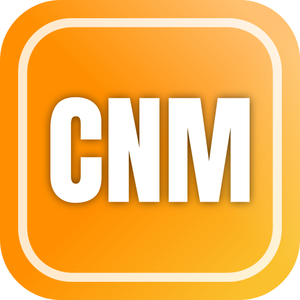

# Camera Network Monitor (CNM)



Camera Network Monitor is a self-hosted web application for watching the
cameras of several recorders (DVR/NVR), IP cameras and other video sources on
freely designed **multiviewer** screens. It runs on a small Linux server in
your own network, needs no cloud service and is built for 24/7 operation.

- **Live multiviewer** – any number of monitors with free layouts. Tiles use
  the light sub stream; a click opens the camera full size in the main stream.
- **Playback and download** – browse the recordings of a camera on a
  timeline, jump, step ±10 s and save a range as an MP4 file.
- **Simple device setup** – choose the protocol (for example *Dahua* or
  *Sofia (DVRIP)*), enter the address and the login, save. CNM finds out the
  rest itself (sub-protocol, login variant, number of channels) and creates the
  cameras automatically. A network search finds devices that are not added yet.
- **Wall displays** – the server can show multiviewers directly on its own
  HDMI/DisplayPort outputs, without a desktop. Other screens can show a
  multiviewer through a kiosk link.
- **Users and kiosks** – administrators and viewers with their own login;
  kiosk links show exactly one multiviewer, live only, and can be revoked at
  any time.
- **Built for continuous operation** – automatic reconnects, no endless login
  attempts with a wrong password (protects recorder accounts against lockouts),
  encrypted storage of recorder passwords, updates without data loss.

The user interface is in **German**.

## Supported protocols

| Protocol | Live | Recording search | Playback / download |
|---|---|---|---|
| Dahua (RPC2 over HTTP or the native protocol, detected automatically) | yes | yes | yes |
| Sofia / DVRIP (XMEye, NETSurveillance) | yes | yes | yes |
| Hikvision (ISAPI) | experimental | experimental | experimental |
| Axis (VAPIX, edge storage) | experimental | experimental | experimental |
| Uniview (RTSP) | experimental | – (availability check) | experimental |
| ONVIF (Profile S/G) | yes | experimental (time span only) | experimental |
| RTSP, RTMP, HTTP stream (MJPEG/H.264/MPEG-TS), raw H.264 over TCP | yes | – | – |

*Experimental* means: implemented from the public protocol documentation and
tested against simulators, but not yet confirmed on real hardware. Devices
without a protocol of their own in CNM can usually be added via ONVIF. Details:
[docs/PROTOCOLS.md](docs/PROTOCOLS.md).

## Requirements

- A Linux server with systemd: **Debian 11+ or Ubuntu 20.04+**, on x86_64
  (amd64), ARM 64-bit (arm64, e.g. Raspberry Pi 4/5) or ARMv7.
- Network access from the server to the recorders and cameras.
- Access to the distribution's package sources during installation (FFmpeg,
  graphics drivers, the compositor and the kiosk browsers are installed from
  there).
- For viewing: a current Chrome, Edge or Firefox. The cameras' H.264/H.265
  video needs a browser with these codecs (plain open-source Chromium builds on
  Windows often lack them).
- Optional, for wall displays: a graphics card with HDMI/DisplayPort outputs.

## Installation

Download the installer or the installation archive from the
[latest release](https://github.com/testbild-media/Camera-Network-Monitor/releases/latest)
and copy it to the server (or build it yourself, see
[Building from source](#building-from-source)). Then, as root:

```bash
tar xzf camera-network-monitor-<version>.tar.gz
cd camera-network-monitor-<version>
./setup.sh
```

Alternatively, use the single-file installer:
`bash camera-network-monitor-<version>-installer.run`.

The setup asks all its questions at the beginning – local displays, graphics
driver (the detected card is preselected), first administrator, which
multiviewer the connected monitors show, firewall – and then installs
everything without further questions. On Debian, become root with `su -`
(with the dash); on Ubuntu, use `sudo`.

When it is done, open `http://<server>:8090/` in a browser and log in.

**Updates:** unpack the new archive and run `./setup.sh` again. Settings,
users, devices and drivers are kept. Step-by-step instructions, unattended
installation, rollback and backups: [docs/OPERATIONS.md](docs/OPERATIONS.md).

## First steps

1. **Add a device** – *Einstellungen → Geräte → Gerät hinzufügen*: choose the
   protocol, enter the address and the login, save. After the first connection
   the device list shows what CNM detected, and its cameras appear under
   *Kameras*. *Netzwerk durchsuchen* lists devices in the network that are not
   added yet.
2. **Name and sort cameras** – *Kameras*: names, aspect ratio, enable/disable;
   *Kamera-Gruppen*: groups such as "Outdoor" or "Warehouse".
3. **Build a multiviewer** – *Monitore / Layouts → Layout bearbeiten*: pick a
   template and drag cameras onto the slots. Dragging a whole device or group
   fills the following slots in reading order.
4. **Watch** – the multiviewer opens on the start page; click a tile for the
   full-size view, use the playback button for recordings.
5. **Wall screens** – assign multiviewers to the server's own outputs under
   *Displays*, or create a kiosk link under *Benutzer* for any other screen.

A complete tour of the user interface: [docs/USER-GUIDE.md](docs/USER-GUIDE.md).

## Documentation

| Document | Content |
|---|---|
| [docs/USER-GUIDE.md](docs/USER-GUIDE.md) | Using CNM: multiviewer, playback, all settings pages |
| [docs/OPERATIONS.md](docs/OPERATIONS.md) | Installation, updates, backups, wall displays, access rights, troubleshooting |
| [docs/PROTOCOLS.md](docs/PROTOCOLS.md) | Supported protocols, automatic detection, network search, verification status |
| [docs/ARCHITECTURE.md](docs/ARCHITECTURE.md) | How CNM is built (for developers) |
| [docs/TESTING.md](docs/TESTING.md) | Automated tests and acceptance criteria |
| [CHANGELOG.md](CHANGELOG.md) | Changes per version |

## Building from source

CNM is a single Go program with the web interface embedded; the live video is
handled by the bundled [go2rtc](https://github.com/AlexxIT/go2rtc), playback by
FFmpeg.

Requirements: Go 1.26 or newer, Python 3, curl and bash (Linux, macOS, or Git
Bash on Windows). Node.js only for the browser-code tests.

```bash
go test ./...                               # tests (playback tests use FFmpeg if present)
scripts/build-release.sh 1.1.0              # packages, installer and complete archive in dist/
```

`build-release.sh` downloads the matching go2rtc release and builds packages
for amd64, arm64 and armv7.

To try CNM without any hardware, start the device simulator next to the
server; it provides simulated recorders of every supported protocol, with test
video and recordings:

```bash
go run ./cmd/cnm-sim --password sim12345
go run ./cmd/cnm serve --data-dir ./data --listen 127.0.0.1:8090
```

## License

CNM is released under the [MIT License](LICENSE). Bundled third-party
software and its licenses are listed in
[THIRD_PARTY_NOTICES.md](THIRD_PARTY_NOTICES.md).
